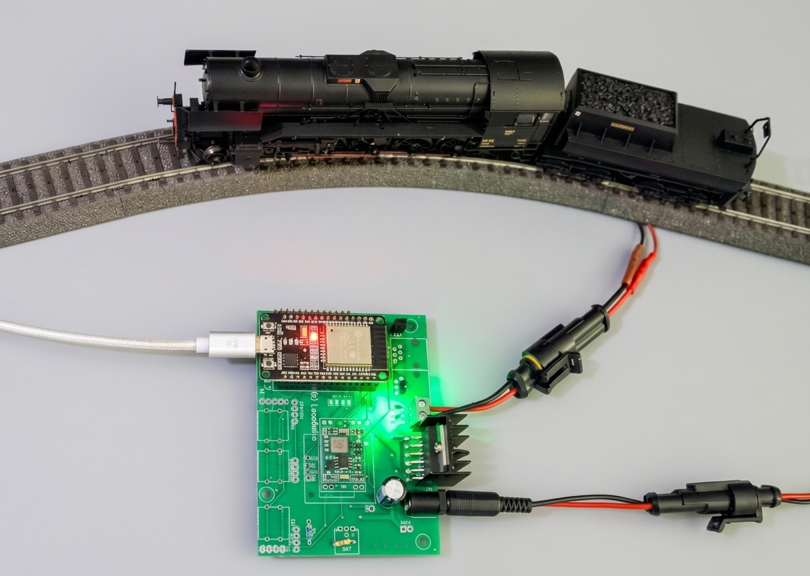
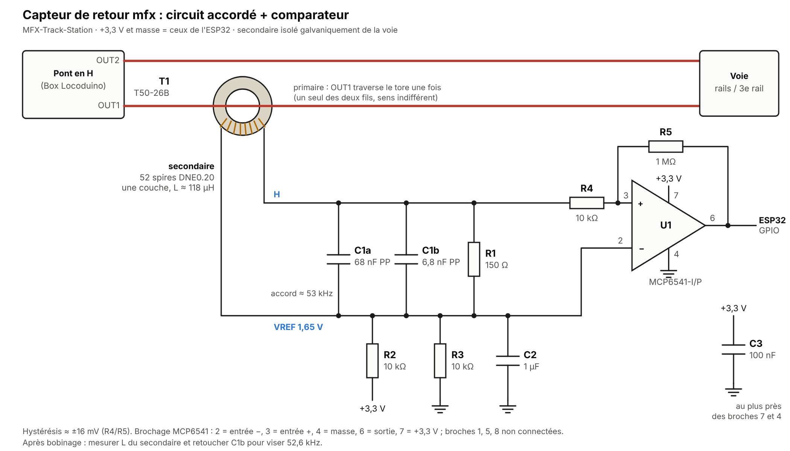

# MFX Track Station

*[Version française](README.md)*

DIY mfx®-compatible digital command station on an ESP32, to drive Märklin locomotives in the mfx format, and in DCC and Motorola MM2 too, without a Gleisbox or a Central Station. The track signal is generated by the RMT peripheral of the ESP32.

*Formerly directMFX_ESP32: the old links redirect here.*

This project has a thread on the 3R forum (in French): https://forum.3rails.fr/t/controler-vos-trains-mfx-depuis-un-arduino-due-sans-passer-par-la-gleisbox/27563

> /!\ Work in progress, but functional: mfx locomotives can be driven from Rocrail.

### What works today

- **mfx signal** generated by the RMT of the ESP32: speed (127 steps), direction and functions F0 to F31: F0 to F15 with the speed, F16 and above one by one (command `100`, Krauss 3.1.6), sent at once then repeated in turn by the refresh.
- **Control from Rocrail** over WiFi, with the CS2 protocol (TCP port 15731). Rocrail can disconnect and reconnect without restarting the command station.
- **The command station behaves as a Märklin Gleisbox**, and Rocrail (option **Master** of the MBUS driver) as the MS2: put an mfx locomotive on the track, the command station finds it and reports it to Rocrail, which gives it an address, reads its name and **creates the locomotive in its list**. Nothing to declare, neither in `src/main.cpp` nor by hand in Rocrail (just save the plan). Tried with four locomotives (two ESU decoders, two Märklin).
- **DCC and MM2, as the Gleisbox**: DCC locomotives (identifiers 0xC000 + address) and Motorola MM2 ones (addresses 1 to 80) are driven from Rocrail or the MS2 (speed, direction, functions: F0 to F28 in DCC, F0 to F4 in MM2). The signal and the refresh follow those of a Gleisbox recorded with a sniffer: DCC half-bits of 58 and 100 µs, preamble of 21 bits, 14, 28 or 128 steps set by the master; MM2 packets of 208 µs sent twice; one packet per locomotive in each round, then about 30 ms of mfx. Every locomotive driven once stays in the refresh, even off the track (the list is kept in memory; serial command `L`).
- **Several locomotives** (up to 16 mfx driven at the same time, 32 DCC and 32 MM).
- **Presence of the locomotives**: each one is queried in turn, as the MS2 does, which keeps its registration; the serial monitor tells when a locomotive leaves the track or comes back.
- **CAN bus and MS2**: an MS2 connected to the CAN bus of the Box drives the command station as a slave (list of the locomotives with their names, speed, direction, functions), Rocrail staying the master and following what is done on the MS2 (see below).
- **Deletion of a locomotive**, as on the MS2 (order of the master, or serial command `D`).
- **Short-circuit protection**: the track is switched off above the threshold (1.6 A on the calibrated prototype, below the saturation of its measurement at about 1.8 A) and only comes back on a Go from Rocrail.
- **FreeRTOS**: each function (signal, reception, current monitoring) runs in its own task.

### Still to do

- Functions of the locomotives in Rocrail: Rocrail reads CVs 25 to 70, which do not match the mfx layout of the decoders; see what the MS2 does.
- Noise of the motors with the 1 MΩ comparator: to be checked during a read.
- Writing of CVs.
- MS2: request "langver" (version of the language file) not answered; measurement channels (current, voltage, temperature) as the Gleisbox.
- Answers to Rocrail (overload).
- Printed circuit board for the feedback sensor.

### Hardware

- **ESP32**: main microcontroller, handles the communications and the control.
- **H-bridge** (for example an L293D or equivalent): drives the power to the rails.
- **Power supply**: suited to the voltage of Märklin tracks (about 18 V).

The Box from Locoduino fits perfectly and gives a complete and proven hardware base (in French): https://forum.locoduino.org/index.php?topic=1618.msg20062#msg20062



Watch on YouTube: https://youtu.be/kIXx-TSOVpQ?si=jwideeNshVRPlX4l

### Feedback

A sensor on one track wire lets the decoders answer the command station. It is used for the **registration of the decoders**, reproduced from recordings of a Märklin MS2 and Gleisbox with a sniffer (track and CAN bus). As with an MS2 and a Gleisbox, the work is shared: **the command station does the work of the Gleisbox, and Rocrail the work of the MS2** (the master, which chooses the addresses and keeps the list of the locomotives).

- **Search**, by the command station: every 2 s, it searches for the mfx decoders that are not registered yet and reads their UID bit by bit, as the Gleisbox does (each bit is first asked at 1, then at 0 without an answer; a pause of 150 ms after an answer). The UID found is **reported to the master** (CAN command 0x01, response).
- **Address assignment** ("bind"), ordered by the master (0x02): sent 4 times, 43 ms apart, each one followed by two synchronisations and a hold of the track of 1.6 ms, as the Gleisbox does. Rocrail chooses the address (the low 12 bits of the UID: 404 for the UID FFE9B194); addresses go from 1 to 16383.
- **Existence query** (0x03) and **read of CVs** (0x07) ordered by the master: Rocrail reads the name of the decoder and CVs 2 to 70 this way, then asks a query, whose answer makes it create the locomotive. A query with the UID 0 makes the decoder forget its address (deletion, as the MS2 does).
- **End of the registration**: with the 040 DE, the Serie 150X and the 150 X 1518, Rocrail never asks this last query (Rocrail 26.10.25, November 2026) and the locomotive does not appear in its list; with the 241 A, it always asks it. The reason is in Rocrail, whose code is not public. When the master has bound and read a decoder and then asks nothing more for 8 s, the command station queries it itself and sends the answer to the master, as if it had asked: Rocrail then creates the locomotive (or finds the one with the same address).
- **Presence**: the command station also queries each known locomotive in turn, between two searches: a decoder that is not queried for 5 to 10 minutes registers again (Krauss, § 4.3). A locomotive that does not answer 3 times in a row is taken as off the track and is queried only once a minute.
- **Driving orders**: as a Gleisbox, the command station sends to the track the orders of the master for any mfx address, even the one of a locomotive registered in another session.

To Rocrail, the command station introduces itself as a Gleisbox: answer to the ping (version 1.47, type 0011, as the recorded Gleisbox), description of the device (command 0x1D), identifier (0x0C), acknowledgement of the system commands (Go, Stop, track protocols, re-registration counter).

The sensor (schematic below):

- **T1**: Micrometals T50-26B iron powder toroid. The track wire OUT1 goes through it once (only one of the two wires). Secondary: 52 turns of 0.20 mm solderable enamelled wire (L ≈ 118 µH).
- **Tuned circuit** at about 53 kHz, the carrier of the answer of the decoders: 68 nF + 6.8 nF (polypropylene) and 150 Ω in parallel with the secondary. Its low end is at VREF = 1.65 V (10 kΩ / 10 kΩ divider decoupled by 1 µF).
- **Comparator** MCP6541 (DIP-8, 3.3 V) with a hysteresis of about ±16 mV (10 kΩ and **1 MΩ**). Its output goes to **GPIO 26** (`FEEDBACK_PIN` in `src/main.cpp`).
  *First value: 330 kΩ (±50 mV). With 330 kΩ, a weak answer is lost as soon as a second loco is on the track (probably because its input capacitors supply part of the current of the answer, which no longer goes through the toroid): the 241 A could no longer be read with the 150 Y on the track. With 1 MΩ (tried with 3 × 330 kΩ in series), it is read without error, and the noise stays at zero when no decoder answers.*

The +3.3 V and the ground are those of the ESP32; the toroid isolates the sensor from the track.

[](/BOBILLEChristophe/MFX-Track-Station/blob/main/include/capteur_retour.png)

**1-bit feedback** (`Feedback::ask()`): after a command that expects an answer (search, verify), the command station inserts its own frame (UID of the command station, counter), sends two synchronisations and the bits 0011, then holds the track at a constant level during two windows of 6.0 ms, as the MS2 does. A decoder answers "yes" in the first one by drawing a current at 52.6 kHz; the second one is a reference for the noise. In each window, the ESP32 counts the intervals of one carrier period (17 to 21 µs) between two rising edges of the comparator (`src/Feedback.cpp`): an answer gives about 300 of them, the noise of a motor almost none, as its edges come at random intervals. The command station takes it as an answer above 150, with at least 120 more than in the reference window, or when a long run of regular intervals (at least 15 in a row) stands well above the noise. A search question without an answer is asked again up to 4 times, 70 ms apart; a verify is not counted as a failure when the reference window is noisy itself.

**Pause after each frame, as the Gleisbox**: after each frame, the command station leaves the track at rest for 1.5 ms (a synchronisation, then no change), as the Gleisbox does nearly everywhere (recorded with the sniffer and an MS2: 1667 pauses in 30 s). Without this rest, the Märklin decoders of the 150 Y 17 and the 241 A did not answer 10 to 15 % of the questions (search, verify); with it, they answered every one (400 out of 400, scenario `Y`).

**End of the request, as the Gleisbox** (recorded with the sniffer and an MS2, November 2026): the answer window is always at the same level of the track, and the bits 0011 are **always followed by a transition**. When they end at the other level, one flip is enough; when they already end at the level of the window, the command station adds a short pulse at the other level. Both matter: the 150 X 1518 and the locomotive at address 1025 answer only with the window at the right level, the 040 DE (recent ESU decoder) only when a transition follows the bits 0011 (without it, its search stopped at bit 8 and it never registered). The pulse lasts about 2 µs on the Gleisbox, but our H-bridge does not reproduce it well: with 2 µs the 040 answered only 29 verifies out of 47, with 5, 10 or 25 µs every one. It lasts 10 µs (`MfxSignal::pulseUs`).

**Reading of CVs** (`Feedback::readCV()`): the command station sends the read command (`111 000`, CV number, index, number of bytes: 1, 2, 4 or 8), then a long pause marked by short pulses (23 every 912 µs, then every 456 µs). The decoder answers during the whole pause by inverting the phase of its carrier: one inversion every 912 µs period, and one more in the middle for a 0 bit. The ESP32 timestamps each edge of the comparator; `lib/MfxDemod` finds the phase inversions, the bits, the bytes, and checks the checksum. The format was recorded on a Märklin Gleisbox and the unit tests decode these real answers. When the track is first powered, the command station reads the configuration of each declared locomotive (`lib/MfxConfig`, like the MS2: block table, name, manufacturer, symbols of functions F0 to F15, acceleration, braking, Vmin, Vmax, tachometer speed) and prints it on the serial monitor; it also does so for each new decoder found. Depending on the decoder, 40 to 70 reads of 2 bytes (as the MS2 does), 15 to 50 s per locomotive: the command station waits 250 ms between two reads, as the MS2 does with an ESU decoder. The configuration is only read while the locomotive stands still (the noise of the motor would disturb the reading); a running locomotive is read later.

Answer of the Serie 150X to a read of a CV, seen on an oscilloscope (Rigol DS1000Z). In yellow, the output of the comparator (GPIO 26): the carrier of the decoder, squared. In blue, GPIO 25 (`Feedback::setScope()`): high while the ESP32 records the edges.


At 5 µs/div, measured with the cursors: the carrier has a period of 19.00 µs, that is 52.63 kHz, and swings from 0 to 3.3 V at the output of the comparator.


At 50 µs/div: the frequency does not change, the information is in the phase changes. In the middle of the screen, a longer pulse shifts everything after it by half a period: this is a phase change. The decoder makes one at each bit boundary (every 912 µs), and one more in the middle of a 0 bit.

**Decoders tested**:

| Locomotive | Decoder | Automatic registration | Reading of the configuration |
|---|---|---|---|
| Serie 150X | ESU, first generation (product `0200000E`) | yes | yes: 60 reads without error, including with another loco running on the track |
| S. 150 X 1518 | ESU (product `02000022`) | yes | yes |
| 150 Y 17 | Märklin (product `0004068B`) | yes | yes: 63 reads without error |
| 241 A 004 EST | Märklin (product `00054D47`) | yes, at the first attempt | yes: 66 reads without error |
| 040 DE | recent ESU (product `020000DA`), with an energy buffer | no: it misses questions | partly: it can be driven, but answers only about one time in two |

**Serial monitor commands** (one letter, then Enter):

- `L`: list of the locomotives known by the command station (address, UID, name).
- `D` followed by the address (for example `D404`): the command station sends a query with the UID 0 to this address, which makes the decoder forget its address (even if the command station does not know it), then forgets it too. If the locomotive is on the track, it registers again at once and Rocrail registers it again. A decoder that did not hear this order (track off, locomotive away) would keep its address and no longer answer the search: the command station therefore keeps the list of the deleted locomotives (NVS) and, every 30 s, asks each address whether its decoder is still there; if it answers, the order to forget is sent again. The same holds for a deletion ordered by the master.
- `C`: read the configuration of every locomotive again; `C224`: of the locomotive 224 only (a few minutes, the end is printed).
- `E`: erase every locomotive in memory; the re-registration counter is increased and the command station restarts.
- `R`: re-registration of every decoder. The re-registration counter is increased (and kept in memory), then the command station restarts; then press Go in Rocrail. Only the locomotives **on the track** at that time register again, one at a time (about 45 s each with the read by Rocrail). A counter sent by the master (system command 0x09, as the MS2 does) is taken too.
- `V`: verify each locomotive ("decoder at address 5, is your UID FFFEBF74?"), with the count of regular intervals in each window.
- `?`: help.

Test bench of the feedback (to tune the detection, two locomotives at most on the track, standing still): `M224,50` asks 50 verify questions to the address 224 and prints, for each, the counts of both windows, the end of the request (`flip`: one flip, `pulse`: the pulse, `none`) and a summary; `N224,5` reads the name 5 times; `S<UID>,n,pause` asks n search questions with the whole UID; `T<UID>` asks the search questions of every length, from 0 to 32 bits; `A` switches the pulse after 0011 off and on; `I<µs>` changes its length; `F<µs>` the delay of the flip (`F0`: none).

**Traces and oscilloscope** (`src/main.cpp`): `Feedback::setTrace(cv, search)` prints one line per read of a CV and/or per 1-bit request of the discovery. `Feedback::setScope(GPIO_NUM_25, mode, address)` sets GPIO 25 high during the windows of the 1-bit feedback (`ONE_BIT`), during the answer to a read of a CV (`DATA`), or both (`BOTH`), to trigger an oscilloscope; `SCOPE_OFF` leaves the pin free.

**Loco list for Rocrail** (`lib/Cs2Config`): like a CS2, the command station answers the "loks" request of Rocrail (command 0x20) with the file `lokomotive.cs2` (command 0x21): name, address, mfx UID and, when the configuration was read in the decoder, acceleration, braking, Vmin, Vmax, tachometer and type of each function. The format of the stream (size, zlib data, CCITT CRC) is the one of `can2lan` from the railroad project of Gerhard Bertelsmann. The command station also answers the ping of Rocrail like a CS2.

### Building

The project builds with PlatformIO. The platform is pinned in `platformio.ini`: pioarduino 55.03.312-1, Arduino core 3.3.12 (ESP-IDF 5.5), with the RMT and PCNT drivers of ESP-IDF 5. The official `espressif32` platform stops at the core 2.0.17; version 0.12.0 is the last one for that core (`espressif32@6.9.0`). The first build downloads the platform (about 1 GB).

### WiFi setup

Copy `src/secrets.h.example` to `src/secrets.h`, then put the name (SSID) and the password of your network in it. This file is ignored by Git: your password never goes to GitHub.

The fixed IP address of the command station (`192.168.1.210` by default) is set in `src/main.cpp`.

### Adding your own locomotives

With the feedback sensor, just put the locomotive on the track (see "Feedback"): it is registered and kept in memory automatically.

Without the sensor, each locomotive is declared in `src/main.cpp` with a (unique) address and the mfx UID of its decoder:

```cpp
loco[2] = Loco::createLoco(5, "150 X 5", 0xFF, 0xE9, 0xB1, 0x94);
```

The UID can be read for example with an MS2 and the `MfxObserver` example of [Railuino](https://github.com/BOBILLEChristophe/Railuino).


### Use with Rocrail

1. Declare an **MBUS** command station (Märklin CAN, TCP sublibrary), with the IP address of the command station and port **15731**.
2. In the **Options** tab, tick **Master**: Rocrail then plays the part of the MS2, gives the addresses and creates the locomotives. Restart Rocrail.
3. Click **Go** to power the track, then put the locomotives on it: each one appears in the list of Rocrail, with its name read in the decoder. **Note**: a locomotive created this way is only temporary for Rocrail (26.10.25); saving the plan is not enough, it disappears when Rocrail is closed. Open its properties, complete them if needed, then confirm (**OK**): it is then kept in the plan. Rocrail leaves its UID field at 0; the mfx UID can be entered there, **in decimal** (Rocrail does not keep a hexadecimal value): F9E610E0 is written 4192604384. The serial monitor prints the UIDs in hexadecimal (command `L`). The **Bind** button of this window is not needed: the command station and the decoder keep the address.

### CAN bus and MS2

The command station has the Märklin CAN bus (250 kbit/s, 29-bit identifiers) of the Box: RX on GPIO 4, TX on GPIO 5, with a 3.3 V CAN transceiver. The library is ACAN_ESP32 by Pierre Molinaro, version 3.0.3 (for the Arduino core 3; 1.1.2 with the core 2.0). An **MS2** connects to this bus as to a Gleisbox, and **drives the command station as a slave** while Rocrail stays the master.

**Gateway, as a CS2.** Each frame of Rocrail is copied to the bus, each frame of the bus is passed to Rocrail. The command station executes the orders of either side (speed, direction, functions, emergency stop of a locomotive, Stop and Go) and answers as a Gleisbox: an order is confirmed (same bytes, response bit), a request gets the state of the locomotive. Rocrail therefore follows what is done on the MS2 (speed slider, functions), and the other way round.

**The MS2 follows a "Central Station".** Rocrail presents itself to the ping as an MS2 of UID 0; the MS2 then asks for its configuration ("ms2-conf") again and again and shows no locomotive. So the command station does what the MaeCAN server does when it is master:

- every 10 s, it sends a ping on the bus and the answer of a CS2 GUI (type FFFF); the ping answer of Rocrail no longer goes to the bus;
- it answers the requests of the MS2 itself: "loknamen" (the list of names) and "lokinfo" (the card of a locomotive: address, UID, speed, direction, functions F0 to F15 and their icons); the answers of Rocrail to the MS2 stay off the bus, so that there is only one.

On the MS2, choose a locomotive in the list and load it (the MS2 does not load them by itself). The locomotives offered are those registered by Rocrail, with the **name read in the decoder** (the command station keeps the name when Rocrail reads it). The **function icons** need the configuration of the decoder: serial command `C`, locomotives on the track; without it, F1 to F15 appear with the generic symbol "Fn".

**Good to know:**

- Start the command station and Rocrail **before** connecting the MS2: it must see the Central Station when it starts.
- The MS2 is powered by its Gleisbox; a real Gleisbox on the bus also executes the orders of Rocrail (registrations, reads) and answers them, sometimes together with the command station. For registrations, it is better off the bus; its track output must not be connected to the rails of the command station.
- The serial log prints each frame received from the bus (lines `CAN:`, pings left out) and each device that answers the ping; `Message::setBusTrace(false)` turns them off. `Message::setSimulateGui(false)` and `Message::setAnswerMs2Conf(false)` give the hand back to Rocrail.
- With Ethernet, `Ethernet.init(5)` also takes GPIO 5: one of the two pins must move.

### Contributing

Contributions are welcome! If you want to take part, please open an **issue** or submit a **pull request**.

### License and thanks

This project is distributed under the AGPL-3.0 license (see `LICENSE`).

Many thanks to Stefan Krauss, who did a huge work on the mfx protocol (in German): http://www.skrauss.de/modellbahn/Schienenformat.pdf

This project is also based on a work by Gérald Litzistorf, which can be found here (in French): https://gelit.ch/Train/DirectMFX.ino and https://gelit.ch/Train/MFX.pdf

### Trademarks

*mfx® is a registered trademark of Gebr. Märklin & Cie GmbH. This project is independent and is not affiliated with, endorsed or sponsored by Märklin.*
